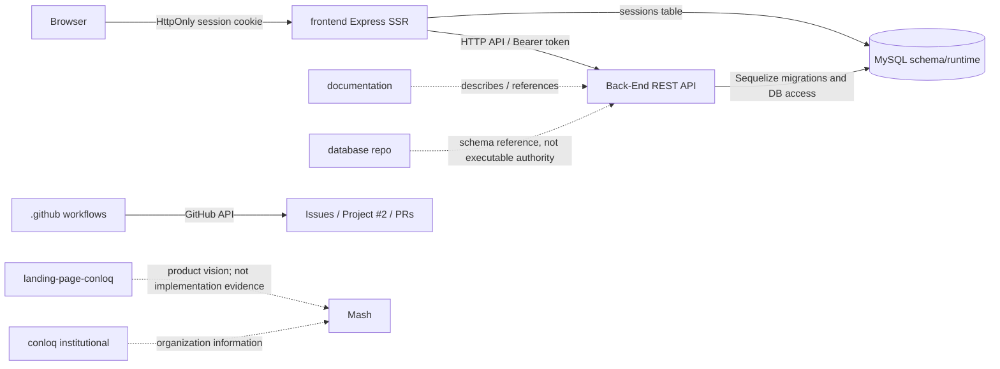

# Conloq/Mash: project context

Use this index before non-trivial work. It points to sources; it is not a snapshot of live work status.

## Project and operational entrypoints

- **Mash**: software project for monitoring the mashing stage in craft-beer production.
- **Canonical work board**: [GitHub Project #2, “Mash”](https://github.com/orgs/conloq/projects/2). Query it live for Status, Priority, Área, Size, Story Points, Sprint, assignments, and other operational fields. A stale/copy Project is not authoritative.
- **Roadmap and durable project decisions**: [`conloq/mash#66`](https://github.com/conloq/mash/issues/66). It records intent and decisions; it does not prove implementation.
- **Current implementation**: inspect code/configuration at the target repository, branch, and SHA. Do not infer implementation from an Issue, README, or product-presentation page.

## Repository registry

| Repository | Role | Runtime? | Primary local evidence |
|---|---|---:|---|
| [`conloq/.github`](https://github.com/conloq/.github) | Organization profile, templates, shared workflows, and GitHub automation | No product runtime | `profile/README.md`, `.github/workflows/`, `automation/README.md` |
| [`conloq/Back-End`](https://github.com/conloq/Back-End) | Mash REST API; owns business rules and executable schema evolution | Yes | `app.js`, `routes/`, `controllers/`, `services/`, `migrations/`, `config/swagger.json` |
| [`conloq/frontend`](https://github.com/conloq/frontend) | Mash web UI; Express EJS server with server-side session consumes the API | Yes | `index.js`, `controllers/pageController.js`, `views/`, `package.json` |
| [`conloq/landing-page-conloq`](https://github.com/conloq/landing-page-conloq) | Institutional/commercial presentation of the complete product vision | Static presentation, not Mash runtime | `index.html`, `assets/` |
| [`conloq/conloq`](https://github.com/conloq/conloq) | Institutional repository of the Conloq organization | No Mash runtime | `README.md`, `pyproject.toml`, `src/conloq/` |
| [`conloq/database`](https://github.com/conloq/database) | Database documentation and reference artifacts | No | `README.md`, SQL/diagram/evidence files; not schema authority |
| [`conloq/documentation`](https://github.com/conloq/documentation) | Human-facing technical, functional, and academic documentation | No | `README.md`, area guides, `geral/` |
| [`conloq/mash`](https://github.com/conloq/mash) | Issue/roadmap home; legacy application code is not the current runtime authority | Legacy/work tracking | Issue #66 for current roadmap/decisions; verify implementation in active runtime repos |

Read each repo’s `AGENTS.md` when present. Local entrypoints add repo-specific commands and boundaries; they do not override live GitHub state or code evidence.

## Canonical links

- Global entrypoint: [`PROJECT_CONTEXT.md`](./PROJECT_CONTEXT.md).
- Shared-repo instructions: [`AGENTS.md`](./AGENTS.md).
- Local entrypoints, when present: [Back-End](https://github.com/conloq/Back-End/blob/main/AGENTS.md), [frontend](https://github.com/conloq/frontend/blob/main/AGENTS.md), [landing page](https://github.com/conloq/landing-page-conloq/blob/main/AGENTS.md), and [institutional repo](https://github.com/conloq/conloq/blob/main/AGENTS.md).
- Cross-repo architecture and evidence: [`documentation/geral/architecture.md`](https://github.com/conloq/documentation/blob/main/geral/architecture.md).
- Context lifecycle: [`documentation/geral/context-lifecycle.md`](https://github.com/conloq/documentation/blob/main/geral/context-lifecycle.md).
- Human documentation index: [`conloq/documentation/README.md`](https://github.com/conloq/documentation/blob/main/README.md).

## Source hierarchy

| Question | Authority |
|---|---|
| What runs now? | Code/configuration at the target SHA, exercised where needed |
| What is the API contract? | Back-End routes/controllers and `config/swagger.json` at the target SHA; compare actual consumers |
| What creates/evolves the database schema? | Back-End Sequelize migrations; `database` is reference documentation |
| What was decided or intended? | Current decision/roadmap text in `conloq/mash#66` and relevant ADR/technical documentation |
| What is the current task/status/priority/sprint/ownership? | Live Project #2, Issue, PR, branch, and check state |
| How should a repeatable process be performed? | Versioned procedures/skills, where available; process instructions are not project-fact authorities |
| How is GitHub accessed? | GitHub UI, API, CLI, or connector; these are transports, not sources of truth |

- Optional coordination-environment skills: [`haimonvieira/conloq-pi-coordenacao`](https://github.com/haimonvieira/conloq-pi-coordenacao), subject to access. They are not required for this portable context core and do not override versioned project sources.

When sources materially disagree about scope, architecture, contracts, security, governance, or completion, stop. Record `DIVERGENT` or `UNKNOWN`, cite both sides, and request an authoritative decision; do not silently choose.

## Cross-repository boundaries

The diagram is a navigation aid. Confirm every edge against code/configuration at the relevant SHA before relying on it for a change. See [`documentation/geral/architecture.md`](https://github.com/conloq/documentation/blob/main/geral/architecture.md).

## Current scope and technical boundaries

- Semester scope, route groups, and deferred features are defined centrally in [`conloq/mash#66`](https://github.com/conloq/mash/issues/66) and [`conloq/documentation/geral/README.md`](https://github.com/conloq/documentation/blob/main/geral/README.md).
- The public landing page presents the complete product vision and is not implementation evidence.
- Re-check current code and `conloq/mash#66` before asserting status for a specific task.

## Integration policy

- Work from a branch and open a Pull Request; do not commit directly to `main`.
- Required human approvals: **0**. A review may be useful but is not a mandatory approval gate.
- Merge eligibility is determined by current branch protection, organization rulesets, required checks, conversation-resolution settings, and actor permissions. Query GitHub live; this file does not enumerate volatile enforcement.

## Context lifecycle

For a non-trivial task: discover the target and SHA, read local/global entrypoints, consult live GitHub state, inspect implementation and consumers, compare relevant durable docs/decisions, and stop on material divergence. After changes, check affected local and cross-repo surfaces and record evidence. The conceptual lifecycle is in [`documentation/geral/context-lifecycle.md`](https://github.com/conloq/documentation/blob/main/geral/context-lifecycle.md); no executable Bootstrap/Sync/Gate is defined by this index.

## Freshness

This file intentionally does not copy issue counts, status values, sprint assignments, open PRs, check results, branch protections, rulesets, or deployment state. Query those sources live. The evidence snapshots in `documentation/geral/architecture.md` identify SHAs used for stable technical claims; re-verify when the target SHA differs.